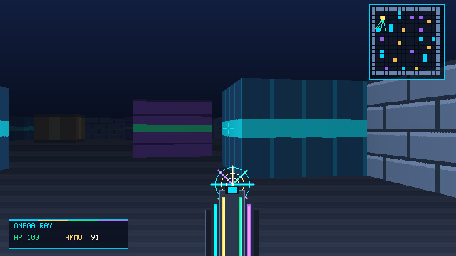
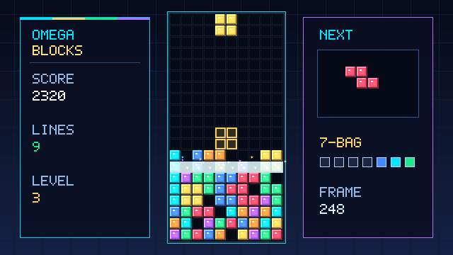
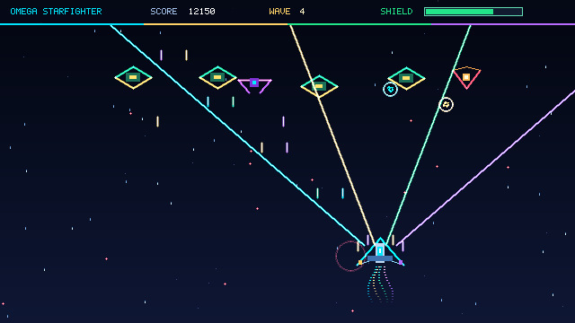

# `omega-arcade`

**Three clean-room classic arcade game engines (`DOOM`-style 3D Raycaster, `Tetris`-style Falling Blocks, and `Starfighter` 4-Strand Vector Shooter) written from scratch in 100% pure seeded Omega (`om2`) — each compiling to a `< 48 KiB` zero-libc static ELF that renders `640×360` software graphics at `1,610–5,650 FPS` inside `< 1 MiB` (`968–976 KB`) of total peak RAM.**

---

## Executive / CEO Summary

Most modern software graphics stacks pull in tens of megabytes of runtimes, garbage collectors, C standard libraries, SDL/GPU drivers, and dynamic allocators just to push pixels to a `640×360` framebuffer. `omega-arcade` tests the opposite extreme: **what happens when complete, playable-logic classic game engines are written from scratch in pure seeded Omega (`om2`) with zero C, zero `libc`, zero SDL, zero Python/Node runtimes, and zero heap allocations?**

Measured on **DGX Spark Grace AArch64 (single Cortex-X925 core, `taskset -c 15`)** and verified natively on **Apple Silicon (`a64macos`)**, with full receipts committed under [`docs/evidence/`](docs/evidence/):

- **Under 50 KiB on disk, under 1 MiB in RAM:** Each complete game engine — including fixed-point math, procedural textures/bevels, AI replay controller, 5×7 pixel font, PPM exporter, and built-in FIPS 180-4 SHA-256 verifier — compiles to a **`40.8–47.1 KiB` standalone static AArch64 ELF** (`0` shared libraries) and peaks at **`968–976 KB` total Linux `VmHWM`**. Since the `640×360×4` framebuffer alone is `900 KB`, **every engine's code, stack, font, SHA-256 state, and entity pools fit in `~68–76 KB` of RAM** — **`2.2×` less RAM than C (`libc.so.6`)**, **`19×–23×` less RAM than Python 3**, and **`60×–62×` less RAM than Node.js v24**.
- **`1,610` to `5,650 FPS` software rendering (`34×–73×` faster than Python 3, beating Node.js V8 JIT on 2 of 3 games):** On a single Cortex-X925 core with mandatory runtime bounds, overflow, and loop-bound traps enabled, Pure Omega sustains **`1,610 FPS`** on the 3D textured DDA raycaster (`46.6×` faster than Python), **`2,808 FPS`** on Falling Blocks (`73.0×` faster than Python, **`1.74×` faster than Node.js v24 V8 JIT**), and **`5,650 FPS`** on Starfighter (`34.0×` faster than Python, **`1.04×` faster than Node.js v24 V8 JIT**).
- **100% 5-Way Bit-Exact Cross-Platform Determinism:** Across **`207,360,000` rendered pixels** (`3 games × 300 frames × 640×360`), **Pure Omega (`a64linux`)**, **Pure Omega (`a64macos`)**, **C11 (`gcc -O3`)**, **Node.js (`v24.21.0`)**, and **Python 3 (`3.12.3`)** match **bit-for-bit** on every hero PPM SHA-256, final frame SHA-256, and 300-frame rolling stream SHA-256.
- **11/11 Security & Negative-Control Checks (`0 FAIL`):** Memory corruption (`Trap 3 / exit 103` & compile-time `error 21`), signed overflow (`Trap 1 / exit 101`), divide-by-zero (`Trap 2 / exit 102`), infinite-loop DoS (`Trap 4 / exit 104`), malformed CLI/map inputs, 1-pixel framebuffer tamper, and hostile mod escape attempts inside `execpure` (`-EPERM`) are all caught deterministically ([`docs/evidence/CWE-CVE-SECURITY-RECEIPT.md`](docs/evidence/CWE-CVE-SECURITY-RECEIPT.md)).

*Zero hype, zero accounts, zero telemetry, nothing for sale — every binary hash, raw log, and offline verification command is in this repository for you to check yourself.*

---

## Visual Showcase (Real `640×360` Frames Rendered by Pure Omega)

Each screenshot below was exported directly as a raw `691,215`-byte `P6` PPM from the pure `.om` binary (verified bit-exact across all 5 targets) and saved as a compact `< 80 KB` JPEG:

| 1. `raycast_doom` (`40.77 KiB` ELF · `1,610 FPS` · `972 KB` RAM) | 2. `blocks_puzzle` (`42.80 KiB` ELF · `2,808 FPS` · `968 KB` RAM) | 3. `starfighter` (`47.05 KiB` ELF · `5,650 FPS` · `976 KB` RAM) |
|---|---|---|
|  |  |  |
| Fixed-point Q12 DDA over `16×16` maze, shaded N/S vs E/W stone & tech walls, depth fog, ceiling/floor gradient, glowing 4-strand blaster + muzzle flare, live FOV minimap. | Full 7-bag tetromino state machine, SRS wall kicks, hard-drop ghost outline, shaded 3D bevel blocks, line-clear scanline flash + 96-particle burst, live pixel-font HUD. | Fixed-pool 3-layer parallax starfield, 3-class enemy formations, quad plasma bolts + 4-strand laser sweep fan, expanding additive RGB glow shockwave rings + sparks. |

---

## Head-to-Head Benchmark (`MEASURED_DGX_SPARK_GRACE_A64`, CPU `15`)

Measured on DGX Spark Grace AArch64 (`Linux 7.0.0-1019-nvidia`, pinned Cortex-X925 core `15`, 3 paired interleaved trials × `300` full `640×360` software-rendered frames, pinned `seed/out/omc` `28fca13d...072`, `gcc 13.3.0 -O3 -mcpu=native`, `Node.js v24.21.0`, `Python 3.12.3`). Peak RAM (`VmHWM`) is read directly from Linux `/proc/self/status` inside each process. Full raw trials live in [`docs/evidence/results.json`](docs/evidence/results.json) and [`docs/evidence/RECEIPT.md`](docs/evidence/RECEIPT.md).

| Game | Engine | Median FPS | µs / Frame | 300-Frame Time | Binary Size | Peak RAM (`VmHWM`) | Speed vs OM-2 | RAM vs OM-2 |
|---|---|---:|---:|---:|---:|---:|---:|---:|
| **`raycast_doom`** | **Pure OM-2 (`a64linux`)** | **`1,609.95`** | **`621.14 µs`** | **`186.34 ms`** | **`40.77 KiB`** (`41,752 B` static) | **`972 KB`** | **`1.00×`** | **`1.00×`** |
| `raycast_doom` | C11 (`gcc -O3 -mcpu=native`) | `6,151.83` | `162.55 µs` | `48.77 ms` | `69.97 KiB` (`libc.so.6`) | `2,140 KB` | `3.82×` faster | `2.20×` more |
| `raycast_doom` | Node.js `v24.21.0` (V8 JIT) | `1,893.01` | `528.26 µs` | `158.48 ms` | V8 runtime | `59,836 KB` | `1.18×` faster | `61.56×` more |
| `raycast_doom` | Python `3.12.3` | `34.56` | `28,937.95 µs` | `8,681.38 ms` | CPython runtime | `22,388 KB` | **`46.58×` slower** | `23.03×` more |
| **`blocks_puzzle`** | **Pure OM-2 (`a64linux`)** | **`2,808.09`** | **`356.11 µs`** | **`106.83 ms`** | **`42.80 KiB`** (`43,832 B` static) | **`968 KB`** | **`1.00×`** | **`1.00×`** |
| `blocks_puzzle` | C11 (`gcc -O3 -mcpu=native`) | `15,946.80` | `62.71 µs` | `18.81 ms` | `70.35 KiB` (`libc.so.6`) | `2,204 KB` | `5.68×` faster | `2.28×` more |
| `blocks_puzzle` | Node.js `v24.21.0` (V8 JIT) | `1,614.24` | `619.49 µs` | `185.85 ms` | V8 runtime | `57,780 KB` | **`1.74×` slower** | `59.69×` more |
| `blocks_puzzle` | Python `3.12.3` | `38.48` | `25,990.55 µs` | `7,797.17 ms` | CPython runtime | `22,012 KB` | **`72.98×` slower** | `22.74×` more |
| **`starfighter`** | **Pure OM-2 (`a64linux`)** | **`5,649.69`** | **`177.00 µs`** | **`53.10 ms`** | **`47.05 KiB`** (`48,184 B` static) | **`976 KB`** | **`1.00×`** | **`1.00×`** |
| `starfighter` | C11 (`gcc -O3 -mcpu=native`) | `34,404.02` | `29.07 µs` | `8.72 ms` | `70.95 KiB` (`libc.so.6`) | `2,148 KB` | `6.09×` faster | `2.20×` more |
| `starfighter` | Node.js `v24.21.0` (V8 JIT) | `5,431.12` | `184.12 µs` | `55.24 ms` | V8 runtime | `60,740 KB` | **`1.04×` slower** | `62.23×` more |
| `starfighter` | Python `3.12.3` | `166.24` | `6,015.41 µs` | `1,804.62 ms` | CPython runtime | `18,884 KB` | **`33.99×` slower** | `19.35×` more |

**Native Apple Silicon (`a64macos` Mach-O, exact same `.om` sources, 3-trial median):**
- `raycast_doom`: **`1,143.15 FPS`** (`874 µs/frame`)
- `blocks_puzzle`: **`1,798.23 FPS`** (`556 µs/frame`)
- `starfighter`: **`3,217.39 FPS`** (`310 µs/frame`)

---

## 5-Way Bit-Exact Frame SHA-256 Parity (`207,360,000` Pixels)

Every target (`Pure Omega a64linux`, `Pure Omega a64macos`, `C11 gcc -O3`, `Node.js v24`, `Python 3.12`) matches **bit-for-bit** on all 9 SHA-256 digests:

| Game | Hero Frame | Hero `P6` PPM SHA-256 (`691,215 B`) | 300-Frame All-Pixel Stream SHA-256 |
|---|---:|---|---|
| `raycast_doom` | `185` | `6bac57339b917c42d89f9ed8481ae08f7b422d0c9f26fe3f48b97351ea736a52` | `fcddd5379dba1f73958f9d32f70ae46146fc58050237890b5255404b87379923` |
| `blocks_puzzle` | `248` | `ddea108ea8b9649dcab8055006f5041a4003c4f567c304c3e77a015f2e8b7535` | `95ea8731949096c035733e0288f306830551ada4e7cc26a20f1e449d2ef1185b` |
| `starfighter` | `195` | `cf1ca2191b3c3f31249f8dd6a4d51e5d1ec9180c15dfeb9a5bf3125e6eb72edf` | `f7ee03c4093b61cb32ac513aa27b16666bd1f04fa368b66107bf2291a9aac82b` |

---

## Security & Negative-Control Gate (`11/11 PASS`, `0 FAIL`)

Full CWE/CVE matrix and raw logs live in [`docs/evidence/CWE-CVE-SECURITY-RECEIPT.md`](docs/evidence/CWE-CVE-SECURITY-RECEIPT.md):
- **`G1` OOB Sprite Write (`CWE-787`):** `probe_oob` trapped deterministically by OM-2 `Trap 3` (`exit 103`).
- **`G2` Signed Integer Overflow (`CWE-190`):** `probe_overflow` trapped by OM-2 `Trap 1` (`exit 101`).
- **`G3` Division by Zero (`CWE-369`):** `probe_div0` trapped by OM-2 `Trap 2` (`exit 102`).
- **`G4` Infinite Loop DoS (`CWE-835`):** `probe_loop` trapped by OM-2 `Trap 4` (`exit 104`).
- **`G5–G6` Malformed CLI & Maze Map Refusal (`CWE-20`):** invalid commands, `frames=0`, `frames=999999`, negative frames, truncated maps, bad tiles, and open maze perimeters all fail closed.
- **`G7` 1-Pixel Framebuffer Tamper (`CWE-345`):** flipping 1 single bit of 1 pixel at `(320, 180)` flips the FIPS 180-4 SHA-256 digest; restoring that bit recovers the exact digest.
- **`G8` Out-of-Bounds Clipping Safety:** negative/off-screen primitives clip cleanly with zero traps.
- **`G9–G10` `execpure` Untrusted Mod Sandbox + Negative Control:** `probe_escape` (`fopen("/etc/passwd")` + `socknew` + `fork`) gets exact `-EPERM` (`rc=77`) inside `execpure`, while the exact same binary breaches (`rc=99`) outside `execpure`.
- **`G11` Compile-Time Static OOB Refusal:** `omc` refuses constant out-of-bounds writes with `error 21` and `0` emitted bytes.

---

## Verify It Yourself Today

```bash
# 1. Build all pure-Omega binaries (auto-detects Linux AArch64 or macOS ARM64)
bash build.sh

# 2. Verify 300-frame bit-exact SHA-256 digests and export a real 640x360 PPM
./bin/raycast_doom verify 300
./bin/raycast_doom ppm > raycaster.ppm && shasum -a 256 raycaster.ppm

# 3. Run full Spark Linux AArch64 gate, 4-way parity check, and 3-trial H2H benchmark
BENCH_CPU=15 TRIALS=3 FRAMES=300 bash bench/bench_arcade.sh

# 4. Verify all committed evidence and screenshot checksums offline
shasum -a 256 -c docs/evidence/SHA256SUMS.txt
```

---

## What Is NOT Built Yet (Honest Caveats)

- **Headless software framebuffer only:** These binaries output raw `P6` PPM streams and SHA-256 verification proofs rather than opening a live X11/Wayland/AppKit interactive window, keyboard event loop, or audio device.
- **Unchecked C (`gcc -O3 -mcpu=native`) is `3.82×–6.09×` faster on raw CPU FPS:** GCC auto-vectorizes row fills with ARMv9 NEON/SVE and removes all array bounds, overflow, and loop-bound checks. Pure OM-2 keeps every safety trap active inside a single-pass seeded compiler (`omc`).
- **`execpure` mod sandboxing is Linux AArch64-only:** Native Apple Silicon (`a64macos`) verifies all 4 language traps (`101..104`) and 100% bit-exact graphics parity, but Linux Landlock/seccomp-BPF `execpure` applies only on Linux AArch64.

---

## Repository Layout

- `om/` — Pure seeded OM-2 sources (`gfx_common.om`, `raycast_doom.om`, `blocks_puzzle.om`, `starfighter.om`, `gate.om`, `probe_*.om`, `hdr_linux.om`, `hdr_macos.om`).
- `ref/{c,node,py}/` — Bit-exact C11, Node.js, and Python 3 reference ports.
- `bench/bench_arcade.sh` — Reproducible Spark build, security gate, parity check, and paired interleaved benchmark harness.
- `docs/screenshots/` — Crisp `< 80 KB` showcase JPEGs rendered directly from verified Pure-Omega PPM frames.
- `docs/evidence/` — [`RECEIPT.md`](docs/evidence/RECEIPT.md), [`CWE-CVE-SECURITY-RECEIPT.md`](docs/evidence/CWE-CVE-SECURITY-RECEIPT.md), [`results.json`](docs/evidence/results.json), [`spark_run.log`](docs/evidence/spark_run.log), and [`SHA256SUMS.txt`](docs/evidence/SHA256SUMS.txt).
- `build.sh` — Dual-target Pure-Omega build script (`a64linux` pinned-SHA `omc` + `a64macos` with `codesign`).
- `LICENSE` — Apache License 2.0.
